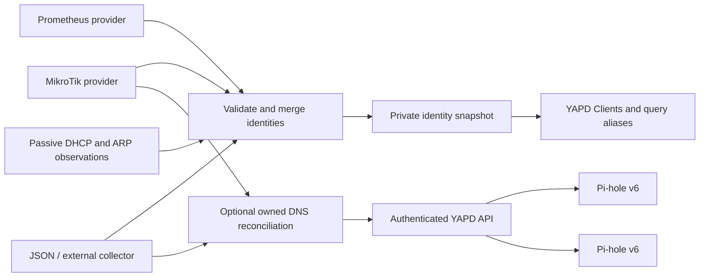

# YAPD Identity Bridge

Bring device identities from **MikroTik, Prometheus, passive DHCP/ARP, or another inventory collector** into [YAPD](https://github.com/leufrasiojunior/yadp). Show useful device names in Clients and query logs, combine multiple sources with explicit precedence, and optionally replicate local DNS records across Pi-hole v6 instances.

The bridge has a provider SDK, a small reconciliation worker, and a version-pinned YAPD backend patch. Providers collect data; the shared core validates, merges, and publishes it. New sources can be added without changing the dashboard integration.

## Supported sources

| Provider | What it reads | How the data is used | Local DNS publishing |
| --- | --- | --- | --- |
| **MikroTik** | DHCP leases and static DNS over RouterOS HTTPS REST | Authoritative lease bindings, device names, local DNS | Yes |
| **Prometheus** | An instant query against metrics with explicit device labels | Observed identities and supplementary names | No |
| **Passive DHCP** | DHCPv4 traffic visible on a Linux LAN interface | Expiring observed MACs, names and allowlisted ACK addresses | No |
| **Passive ARP** | ARP senders visible on that interface within explicit IPv4 CIDRs | Expiring MAC/IP observations, including devices absent from DHCP | No |
| **JSON** | A versioned snapshot written by an external collector | Authoritative bindings or observations, as configured | Optional |

Use one source or combine several. Authoritative bindings take precedence over observations; configured priority resolves differences within each class. Ambiguous address ownership is omitted and reported. **At most one provider may publish DNS.** An identity-only setup makes no DNS configuration calls and preserves previously deployed records.

MikroTik is the default when using `.env.example` without a provider configuration file. Prometheus is implemented and covered by HTTP fixture tests; it requires your own exporter query and label mapping. No live Prometheus deployment is claimed. Passive DHCP uses a separate Linux collector with capture privileges; the main worker remains unprivileged. Optional Loki notifications or authenticated webhooks can trigger earlier refreshes with any vendor’s matching events. UniFi remains a future provider.

See [PROVIDERS.md](PROVIDERS.md) for the SDK, configuration, precedence, and failure handling.

## How it works



The worker polls configured providers every five minutes by default. It runs as a non-root Compose service alongside YAPD and shares its inventory directory with the dashboard through a read-only mount. The worker uses Python's standard library; it needs no extra database, message broker, client agent, or packet-capture privileges. The optional DHCP collector runs separately with narrowly scoped startup capabilities and drops to a non-root UID before decoding packets. Prometheus is only needed if you choose that provider. Existing DNS resolution continues when the worker or dashboard is offline.

The MikroTik adapter performs GET requests only. The bridge does not change router settings, DHCP advertisements, firewall rules, subscriptions, or filtering-group assignments.

## What you get

- Provider-labelled device inventory, including DHCP devices that have not queried Pi-hole. Imported names supplement existing manual aliases and tags.
- Query-log names enriched from current identity bindings. Query counts, activity timestamps, and observed MACs are never invented; uncorrelated activity and policy are labelled.
- Optional replication of static A/AAAA records, CNAMEs, supported forwarding rules, and safe DHCP-derived local names. Explicit static records take precedence over DHCP names.
- Ownership tracking that preserves manual DNS entries and removes only exact entries previously created by the bridge. Identical pre-existing records are borrowed, not claimed.
- Dry-run previews, persisted write intent, read-back verification, pending replica status, and retries after partial failure.
- Per-source last-good caches, original retrieval timestamps, visible stale data, TLS validation, secret files, resource limits, and bounded operational logs.

## Prometheus example

If an existing exporter exposes a series with device labels such as:

```text
network_device_info{mac="AA:BB:CC:DD:EE:01",ip="192.168.50.20",hostname="laptop",network="users"} 1
```

…the Prometheus provider can turn it into an **observed identity** in YAPD. `network_device_info` is an illustrative metric, not a bundled exporter or a metric this project creates. Generic `up` metrics and exporter `instance` labels do not supply device identity automatically.

For a Prometheus-only setup, put the following in your private `secrets/providers.json`, replacing the URL and query with your actual source:

```json
{
  "version": 1,
  "providers": [{
    "id": "metrics",
    "type": "prometheus",
    "priority": 10,
    "config": {
      "url": "https://prometheus.home.arpa",
      "query": "timestamp(network_device_info)",
      "value_is_timestamp": true,
      "max_sample_age_seconds": 300,
      "labels": {
        "mac": "mac",
        "ip": "ip",
        "name": "hostname",
        "network": "network"
      }
    }
  }]
}
```

Set `IDENTITY_PROVIDERS_FILE=/run/secrets/providers.json` in `.env`. The Compose example mounts `secrets/` read-only at `/run/secrets`. Router credentials and YAPD API login credentials are not required by an identity-only Prometheus worker; the existing dashboard still uses its own authentication.

The adapter calls the supported [Prometheus instant-query API](https://prometheus.io/docs/prometheus/latest/querying/api/#instant-queries). The `timestamp(...)` query above exposes the original sample time as the value, so stale scrapes are not mistaken for fresh identity observations. An info metric's value `1` does not establish that a device is online. Without a valid MAC, an IP-only observation can supplement an existing known binding but cannot create a device row. Metrics never become authoritative leases or publish DNS.

To combine MikroTik and Prometheus, start from [providers.example.json](providers.example.json). For bearer tokens, custom CAs, explicit private-network HTTP opt-in, and other labels, see [PROVIDERS.md](PROVIDERS.md#prometheus). Credentials belong in secret files, not query strings or provider JSON.

## Deploy

Start with an existing HTTPS YAPD deployment connected to your Pi-holes. The included Compose file is an overlay for that deployment, not a complete replacement stack.

```sh
git clone https://github.com/alexcf/yapd-identity-bridge.git
cd yapd-identity-bridge
cp .env.example .env
mkdir -p state secrets
chmod 700 state secrets
chmod 600 .env
docker build -t yapd:identity yapd-patch
```

Choose your providers before starting the worker:

| Setup | Configuration |
| --- | --- |
| MikroTik only | Configure the `MIKROTIK_*` settings in `.env.example`; no provider file is needed. |
| Prometheus only | Use the private provider file above and set `IDENTITY_PROVIDERS_FILE`. |
| Multiple sources | Adapt [providers.example.json](providers.example.json) into your private provider file. |
| Passive DHCP | Follow [PASSIVE-DHCP.md](PASSIVE-DHCP.md) and add the collector plus its file provider. |
| Passive ARP | Enable the same collector's ARP option and add its separate `arp` provider; see [PASSIVE-ARP.md](PASSIVE-ARP.md). |
| External JSON collector | Set `IDENTITY_PROVIDER=json` and `IDENTITY_SOURCE_FILE` to its mounted snapshot path; see the format below. |

For MikroTik, supply `secrets/router-password` and, when required, `secrets/router-ca.pem`. An explicitly trusted router leaf or CA certificate is supported; hostname and certificate validity checks remain enabled. Omit the CA setting only when the router chains to the system trust store. Use an account with only the permissions needed for the REST reads.

A DNS-publishing setup also needs `YAPD_BASE_URL` and `secrets/yapd-password`. The worker uses YAPD's existing authenticated administrator API over HTTPS, including its CSRF protection and Secure session cookies. Protect secret files with mode 0600 and ownership matching the worker UID. Password files are re-read each polling cycle; update them when credentials rotate.

For MikroTik-derived DNS, configure `LOCAL_DNS_SUFFIX` and `DNS_SELF_ADDRESSES`. Include the router, Pi-hole nodes, VIPs, and service addresses in the latter to reject direct forwarding loops. Subtree forwarders need an explicit `FORWARD_REVERSE_CIDRS` map, for example `{"example.ts.net":"100.64.0.0/10"}`. This delegates reverse lookups for that CIDR too; review the mapping and downstream forwarding path before applying.

Merge [compose.example.yaml](compose.example.yaml) into your YAPD Compose project, adjusting build paths, image names, mounts, and UID/GID. The patched dashboard needs `YAPD_IDENTITY_FILE` and the read-only state mount shown in that example.

Preview before starting the scheduled service:

```sh
docker compose run --rm --no-deps identity python bridge.py
```

Review the private `state/preview.json` and `state/status.json`, including warnings, conflicts, and proposed DNS changes. Then explicitly apply and start reconciliation:

```sh
docker compose run --rm --no-deps identity python bridge.py --apply
docker compose up -d yapd identity
```

The service command applies on a schedule. Start it only after reviewing the first preview. Keep and back up the state directory: losing `ownership.json` loses the knowledge needed to safely remove retired imported records. Back up state, the YAPD database, and matching credentials together.

## External collectors and new providers

The YAPD patch consumes a private v1 inventory snapshot with this shape. Replace the illustrative timestamp with the time of a real successful collection:

```json
{
  "version": 1,
  "provider": "Example inventory",
  "retrievedAt": "2026-01-01T00:00:00+00:00",
  "devices": [{
    "mac": "AA:BB:CC:DD:EE:01",
    "ips": ["192.168.50.20"],
    "name": "laptop",
    "network": "users",
    "isStatic": false,
    "active": true
  }]
}
```

For the JSON provider, wrap this as `{"inventory": <snapshot>}` and optionally add `dns` and `warnings`, matching `preview.json`. DNS supports `hosts` (`IP hostname`), `cnameRecords` (`alias,target`), and `revServers` (`true,CIDR,server[#port],zone`). The JSON provider defaults to binding authority and DNS publishing. For an identity-only observational collector, use a provider configuration file with `publish_dns: false` and `binding_authority: false` in its `config` before previewing. Incoming snapshots and state contain private network inventory.

A new Python adapter implements `IdentityProvider`, declares its capabilities, and returns `ProviderResult`. Register its factory or install a trusted package using the `yapd_identity.providers` entry-point group. See [PROVIDERS.md](PROVIDERS.md#implementing-another-adapter) for the contract and validation rules. Provider packages execute trusted operator code; configuration does not load arbitrary Python module paths.

## Identity, policy, and current limitations

**Device discovery does not assign a filtering policy.** DHCP MACs describe inventory; routed DNS traffic does not expose those device MACs to Pi-hole. The patch guards against MAC-policy writes for imported devices whose MAC Pi-hole has not observed. Routed clients need explicit IP-based rules; automatic migration of those rules when DHCP changes is not implemented.

A valid lease does not establish online presence. Private MAC rotation creates a separate identity; hostname similarity does not automatically merge devices. IPv6 privacy addresses, static devices outside DHCP, NAT, VPNs, and encrypted DNS can leave gaps in attribution. Query aliases currently use the latest bindings; historical attribution across IP reuse needs timestamped binding history, which is not implemented.

Source failures preserve last-good state. Partial failures mark cached identities stale; snapshots older than 15 minutes are also labelled stale in YAPD. Cached bindings can become outdated during an outage. The bridge does not yet enforce a maximum attribution lifetime or infer presence from a missing DHCP broadcast.

Per-record static TTLs are not preserved in Pi-hole's local-host arrays. Regex DNS records and exact-name-only forwarding are reported as unsupported; CNAME targets must resolve. Supported subtree forwarding uses `dns.revServers`; raw DNSMasq configuration is never written around the protected API. Direct forwarding loops are rejected, but arbitrary multi-hop loops require operator review.

DNS patches preserve unrelated settings and manual overrides. The upstream APIs provide no compare-and-swap transaction for these arrays; avoid concurrent writers to the same settings during reconciliation.

## Passive DHCP and optional event notifications

[Passive DHCP](PASSIVE-DHCP.md) learns MACs/names from visible DHCPv4 messages and short-lived IP observations from allowlisted ACKs. It uses an existing LAN access interface without enabling promiscuous mode. Requested addresses are not assignments; lease deadlines expire independently in the bridge and YAPD reader. The first implementation excludes DHCPv6, relays and arbitrary trunk capture. No filtering groups or DNS records are written by this provider.

[Passive ARP](PASSIVE-ARP.md) optionally learns short-lived IPv4 sender/MAC observations on that interface, including devices absent from DHCP. It does not probe, infer hostnames, classify an address as statically configured, or mark devices offline when quiet. Explicit local CIDRs and gateway/proxy MAC exclusions constrain attribution. Separate DHCP and ARP snapshots preserve each protocol's evidence and deadlines. YAPD shows `Observed: ARP` and `Observed: DHCP` tags without inventing query activity.

[Loki notifications](TRIGGERS.md) are optional. Set `IDENTITY_TRIGGER_FILE` to a private configuration based on [trigger.example.json](trigger.example.json). A configurable LogQL query selects events from any vendor; the notifier does not parse MikroTik-specific messages. Matching events request a debounced full reconciliation of the existing providers. Configuration/runtime failures leave regular scheduled sync active. Omit the setting to disable Loki polling.

A [generic authenticated webhook](WEBHOOKS.md) accepts refresh hints from Grafana/Loki alerting, Prometheus Alertmanager and other publishers. It can run alongside direct Loki polling or replace it. Passive file changes refresh local observations using retained authority, without router or Pi-hole API calls; conflicts request authoritative confirmation. A shared short-lived event key coalesces normalized LAN/log/webhook duplicates while periodic full sync remains independent.

Notifications say when to refresh; providers supply validated state. Neither captured packets nor log messages directly grant permissions or transfer filtering-group membership. [PASSIVE-DHCP.md](PASSIVE-DHCP.md) and [TRIGGERS.md](TRIGGERS.md) cover setup, freshness, limits and verification.

## Compatibility and verification

The dashboard patch targets **YAPD 1.0.0**, source revision `df9633ed6ee1941e22eec7a3faaa4b0817dd4459`. The upstream container is pinned by digest. The complete path has been exercised with RouterOS 7 REST and Pi-hole Core 6.5 / Web 6.6.1 / FTL 6.8. Prometheus is verified against HTTP fixtures and sample responses; it is not advertised as a tested live exporter integration.

The patch uses the existing backend dependencies, frontend fields, and database schema. It is not an official upstream plugin API. The review branch is [alexcf/yadp:feat/external-identity-provider-20261029](https://github.com/alexcf/yadp/tree/feat/external-identity-provider-20261029); no upstream pull request has been submitted. Review and test against other YAPD releases. See [UPSTREAM.md](UPSTREAM.md).

## Operations and recovery

| File | Purpose |
| --- | --- |
| `state/status.json` | Provider freshness, source counts, warnings, and replica application status |
| `state/local-status.json` | Local-only observation refreshes and retained source timestamps |
| `state/inventory.json` | Last validated inventory consumed by YAPD |
| `state/providers/*.json` | Configuration-bound last-good source caches |
| `state/ownership.json` | Owned DNS entries and pending write intent |
| `state/before-*.json` | Topic snapshots taken before changes |

Inspect bounded logs with `docker compose logs --tail=100 identity`. Stop the identity service to pause reconciliation; deployed DNS records remain. To roll back dashboard code, restore the pinned upstream image and remove the snapshot environment setting and mount. To remove imported DNS records, compare current values with the ownership manifest and remove only matching owned entries through YAPD. Preserve newer manual changes.

## Develop and test

```sh
python3 -m unittest discover -s tests -v
docker build -t yapd-identity-test yapd-patch
```

Tests also cover DHCP packet decoding, ACK trust, ARP sender attribution and proxy guards, expiry through cached snapshots, portable Loki notifications and scheduled-sync fallback. Tests cover provider registration and installed entry points, capability enforcement, precedence and conflicts, cache recovery, Prometheus query fixtures and sample freshness, metadata-only DNS preservation, DHCP name injection, expired leases, forwarding loops, CNAME cycles, manual overrides, partial replication, provenance, and aliases. The image build runs the TypeScript tests and compiles the full patched backend.

To regenerate patched service files from an unpatched checkout of the pinned YAPD revision:

```sh
YAPD_SOURCE=/path/to/yadp python3 yapd-patch/prepare_patch.py
```

The script checks expected source anchors. `yapd-patch/identity-provider.patch` is the matching standalone source patch; `yapd-patch/patched/` supplies complete service files for the image overlay. Upstream's MIT license is retained in `yapd-patch/UPSTREAM-LICENSE`.
