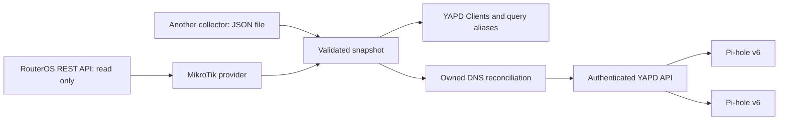

# YAPD external identity and MikroTik DNS bridge

A small, self-hosted integration for [YAPD](https://github.com/leufrasiojunior/yadp) and Pi-hole v6. It imports a DHCP-backed device inventory, enriches query-log client names, and reconciles owned local DNS records across the Pi-holes registered in YAPD.

MikroTik RouterOS is the first source adapter. The YAPD adapter consumes a versioned, provider-neutral identity snapshot; a JSON-file source lets another collector supply the same interface. This is an integration plus a small, version-pinned YAPD source patch—not an official plugin API or an upstream-endorsed module.

## How it works



It reads **directly from RouterOS's HTTPS REST API**, not Prometheus. Polling defaults to five minutes. The router account requires only the access needed for REST reads; the service performs only GET requests to DHCP leases and static DNS. It never changes router settings, DHCP options, firewall rules, DNS subscriptions, or filtering groups.

The worker runs as a non-root Docker Compose service alongside YAPD. It shares a private snapshot directory with YAPD, mounted read-only in the dashboard container. No extra VM, database, message broker, router script, or client agent is required. Existing Pi-hole DNS and firewall enforcement do not depend on the worker or dashboard being available.

## Features

- DHCP MAC/IP/name bindings shown in YAPD's Clients page, including devices that have not queried Pi-hole.
- Imported identities are labelled with their provider. Query counts and timestamps are not fabricated; uncorrelated activity and policy are explicitly tagged.
- Current DHCP bindings enrich query-log aliases. Manually assigned aliases and tags take priority.
- Static A/AAAA records, local CNAME syntax, and subtree forwarding rules can be replicated through YAPD.
- Safe DHCP hostname publication: only short names and the configured local suffix are accepted. Arbitrary public names supplied by DHCP clients are rejected.
- Explicit static DNS wins over DHCP names. Duplicate/conflicting DHCP names or IP ownership are reported rather than guessed.
- Ownership manifests preserve manual DNS entries. Only exact entries previously created by this integration can be removed. Identical pre-existing entries are borrowed, not claimed.
- Preview by default; explicit `--apply` for changes. Intent is persisted before API writes, allowing retries after partial failure.
- Offline replicas are marked pending and retried. Source errors retain the last successfully applied configuration. Inventory older than 15 minutes is visibly stale.
- TLS certificate validation, CSRF-protected YAPD requests, file-based secrets, bounded logs, resource limits, and a freshness/replication health check.

## Compatibility

The dashboard patch targets **YAPD 1.0.0**, source revision `df9633ed6ee1941e22eec7a3faaa4b0817dd4459`, with the upstream container pinned by digest. It has been built and exercised with RouterOS 7 REST and Pi-hole Core 6.5 / Web 6.6.1 / FTL 6.8. Review and test the patch against other releases; do not blindly apply it to a different upstream version.

The TypeScript compiler and existing dependencies in the pinned image build the backend patch. The frontend and existing database schema remain unchanged. `yapd-patch/identity-provider.patch` is an upstream-style patch. `yapd-patch/patched/` contains the matching complete source files for the image overlay. Upstream's MIT license is retained in `yapd-patch/UPSTREAM-LICENSE`.

## Deploy

Start with an existing, working HTTPS YAPD deployment connected to your Pi-holes.

```sh
git clone https://github.com/alexcf/yapd-mikrotik-identity.git
cd yapd-mikrotik-identity
cp .env.example .env
mkdir -p state secrets
chmod 700 state secrets
chmod 600 .env
docker build -t yapd:identity yapd-patch
```

Configure `.env` for your environment. Supply `secrets/router-password`, `secrets/router-ca.pem`, and `secrets/yapd-password`; protect them with mode 0600 and ownership matching the non-root worker UID. The CA file may be an explicitly trusted router leaf or CA certificate; hostname and certificate validity checks remain enabled. Omit the CA setting only when the router already chains to the system trust store. Do not disable TLS validation.

YAPD must be reached over HTTPS so its Secure session cookies work. The worker uses the existing password-only administrator login and current authenticated API; credentials stay server-side. If that password rotates, update its secret file as well. Secrets are re-read each polling cycle.

Set `LOCAL_DNS_SUFFIX` and `DNS_SELF_ADDRESSES` to your site. For a forwarding zone, set `FORWARD_REVERSE_CIDRS` to a JSON map of zone to reverse CIDR, for example `{"example.ts.net":"100.64.0.0/10"}`. This also delegates reverse lookups for that CIDR, so review the mapping before applying. Include the Pi-hole node addresses, any DNS VIP/service addresses, and the router address in the latter so direct forwarding loops are rejected. The worker does not discover arbitrary multi-hop DNS loops; verify downstream forwarders before applying.

Merge `compose.example.yaml` into your YAPD Compose project, adjusting image names, paths, and UID/GID. The example is an overlay, not a complete replacement for the upstream PostgreSQL/YAPD stack. Avoid creating a second dashboard or database accidentally.

Preview:

```sh
docker compose run --rm --no-deps identity python bridge.py
```

Review the private `state/preview.json`, including conflicts and warnings. Then explicitly apply once:

```sh
docker compose run --rm --no-deps identity python bridge.py --apply
docker compose up -d yapd identity
```

The normal service command applies and reconciles on a schedule. Start it only after reviewing the first preview. Keep the state directory: losing `ownership.json` loses the knowledge required to safely remove retired imported records. Back up it, the YAPD database, and matching credentials together.

## Other identity providers

The dashboard accepts this inventory format through `YAPD_IDENTITY_FILE`:

```json
{
  "version": 1,
  "provider": "Example DHCP",
  "retrievedAt": "2026-01-01T00:00:00+00:00",
  "devices": [{
    "mac": "AA:BB:CC:DD:EE:01",
    "ips": ["192.168.50.20"],
    "name": "laptop",
    "network": "users",
    "isStatic": false,
    "active": true
  }]
}
```

An external collector can publish the `inventory` plus `dns` structure emitted in `preview.json`, then use `IDENTITY_PROVIDER=json` and `IDENTITY_SOURCE_FILE=/path/to/snapshot.json`. Supported DNS arrays are `hosts` (`IP hostname`), `cnameRecords` (`alias,target`), and `revServers` (`true,CIDR,server[#port],zone` entries only). These are destination Pi-hole representations, independent of the source vendor. No other router vendors are implemented here yet.

The timestamp must represent an actual successful source read. Do not refresh it while replaying old data. Mount incoming files and state privately; they contain network inventory. The API remains protected by YAPD's existing authentication.

## Policy and identity boundaries

**Importing a device does not assign a filtering policy.** A MAC provided by DHCP is an inventory identity, not proof that Pi-hole can observe that MAC on a routed DNS packet. The patch prevents MAC-based group mutations on DHCP-only clients when Pi-hole has not observed their MAC. Routed/VLAN device policies need explicit IP-based client rules and stable identity management; automatic DHCP-to-policy migration is outside this integration.

IPv6 privacy addresses, devices with static addresses outside DHCP, NAT, VPNs, and encrypted DNS need additional attribution sources. This bridge imports the DHCP records supplied by RouterOS; it does not invent missing IPv6/MAC associations. Native Pi-hole activity may remain uncorrelated for some routed devices. Use query-log client IP/aliases for those devices rather than interpreting a zero inventory counter as proof of no activity.

Static record TTLs are not reproduced per entry in Pi-hole's local-host arrays. Regex DNS records and exact-name-only forwarding rules are reported as unsupported. Local CNAME targets must also be resolvable in Pi-hole. Subtree forwarders use Pi-hole’s supported `dns.revServers` API and retain their configured destination servers. Configure `FORWARD_REVERSE_CIDRS` with the corresponding reverse network for each zone; otherwise those rules are reported and skipped. Catch-all reverse networks are rejected. Raw DNSMasq configuration is never written through or around the protected API.

The worker sends minimal DNS-array patches through YAPD, preserving unrelated settings. Neither upstream API offers a compare-and-swap transaction for those arrays; avoid concurrent manual editing of the same arrays during a sync. Conflicts detected at reconciliation are retained as manual overrides and reported. This is not a general authoritative policy engine or multi-writer database merge system.

## Operations and recovery

- `state/status.json`: latest source counts, conflicts, warnings, per-instance application/pending state.
- `state/inventory.json`: last validated inventory read by YAPD.
- `state/ownership.json`: per-instance owned DNS entries and pending intent.
- `state/before-*.json`: pre-change topic snapshots for recovery.
- `docker compose logs --tail=100 identity`: bounded operational log without passwords or full inventories.

Stop the `identity` service to pause reconciliation; deployed DNS entries remain. To roll back dashboard code, restore the pinned upstream image and remove `YAPD_IDENTITY_FILE`/the read-only inventory mount. To remove imported DNS entries, compare the ownership manifest with current Pi-hole settings and remove only matching owned values through YAPD; preserve manual overrides. Do not restore an entire shared DNS configuration if newer manual edits would be lost.

## Test and develop

```sh
python3 -m unittest discover -s tests -v
docker build -t yapd-identity-test yapd-patch
```

Tests cover conflicting names/IP ownership, DHCP public-name injection, expired leases, forwarding loops, CNAME cycles, manual overrides, borrowed entries, partial replication/reconnection, last-good preservation, client inventory provenance, stale data, and manual query aliases. The image build compiles the patched TypeScript backend.

To regenerate patched source files from a checkout of the pinned upstream revision:

```sh
YAPD_SOURCE=/path/to/yadp python3 yapd-patch/prepare_patch.py
```

The preparation script checks expected source anchors and fails if they change. See [UPSTREAM.md](UPSTREAM.md) for the proposed upstream integration boundary.
